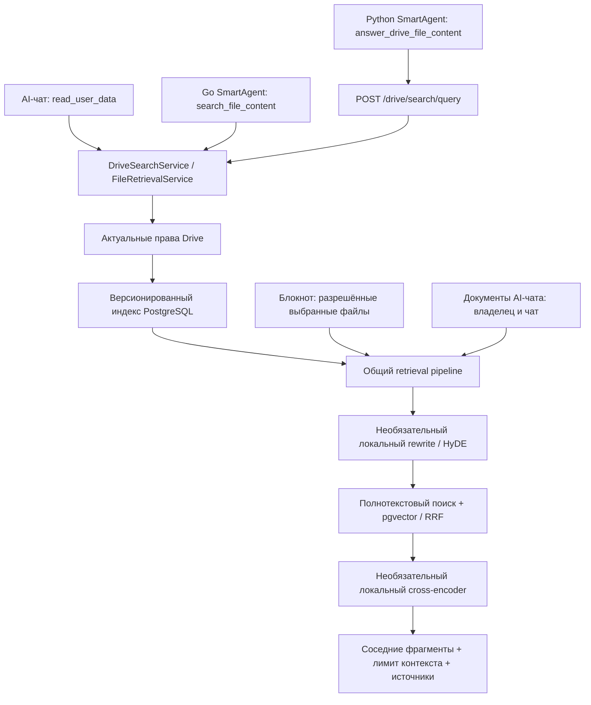

# Общая архитектура поиска по файлам

Цель: перенести сильные этапы поиска из Alem-Code в текущую систему, сохранив
проверки доступа, общий учёт платных вызовов и существующие HTTP-контракты.
Этот документ описывает реализацию в локальном коде, а не факт выпуска на сервер.

## Границы компонентов



`internal/documentsearch` — общий контракт фрагмента, подготовка запроса,
разбиение с перекрытием, объединение рангов и клиент локального reranker.
Здесь нет пользовательских ACL: **адаптер обязан проверить их до передачи
текста**. Сгенерированный HyDE-текст используется только для поиска и никогда
не становится доказательством, цитатой или содержимым документа.

`FileRetrievalService` — извлечение и поиск Drive, а не второй AI-агент. Python
агент больше не нуждается в собственной реализации Elasticsearch/ACL: он
передаёт текущий Authorization в штатный backend. Go-агент и обычный AI-чат
используют тот же сервис. Блокнот сохраняет ACL выбранных источников, чтение
коротких файлов целиком, квоты длинных файлов и стабильные координаты строк;
для ранжирования использует общий pipeline.

Документы чата остаются в `ai_document_*` со своей областью user/chat. Их
перенос в Drive не выполняется: это разные права и жизненные циклы. Общими
стали алгоритмы retrieval и кэш embeddings, а не разрешения на документы.

`DRIVE_SEARCH_BACKEND=postgres` — новый штатный адаптер. `elasticsearch` явно
выбирает старый путь; он не используется как скрытый fallback. Ограничения
`unaccountedDriveProvider` для платных моделей не сняты. Все новые этапы моделей
настроены на собственные локальные сервисы; генерация ответа по-прежнему
проходит существующий механизм списаний и лимитов.

## Индексация и свежесть

Миграция `20261022150000_shared_file_retrieval.sql` создаёт:

- `ai_file_search_documents`: состояние, ревизия файла, попытки, lease и token;
- `ai_file_search_chunks`: текст с перекрытием, координаты и GIN-индексы
  полнотекстового поиска `simple` и `russian`.

Существующий `ai-document-worker` обнаруживает старые/обновлённые файлы
партиями до 20 и обрабатывает одно задание Drive за цикл. События загрузки
также ставят файл в постоянную очередь. Периодический обход восстанавливает
пропущенные события, без дополнительного небезопасного ручного backfill.
Обрабатываются PDF, DOCX, TXT, XLSX, PPTX размером до 50 MiB.

Очередь вложений AI-чата тоже защищена номером попытки: создание документа и
задания транзакционно, старый worker не может заменить фрагменты или понизить
готовый результат, исчерпанные попытки переходят в failed. Обновление ошибки
сделано одной транзакцией с отдельными prepared statements pgx. Удаление
повторно проверяется под блокировкой строки перед постановкой повтора.
Слот обработки резервируется до выдачи lease; между ограниченными партиями
вложений выполняется обслуживание Drive. Контекст отмены передаётся в парсер
и OCR, а финальное состояние сохраняется отдельным ограниченным контекстом.

Сбой повторяется с паузой 5 минут, максимум 3 попытки для одной версии.
Истёкшее задание может забрать другой worker. `lease_token` и проверка
`files.updated_at` не дают старому worker опубликовать результат поверх
новой версии или нового владельца lease. Новая версия сбрасывает попытки.
Публикация текста и состояния выполняется транзакционно. Старые фрагменты
сразу исключаются из поиска при изменении source_updated_at. Мягко удалённые
файлы недоступны немедленно и очищаются из индекса фоновыми партиями.

Embeddings создаются отдельно после готовности текста. Недоступность локальной
модели не делает документ нечитаемым и не блокирует полнотекстовый поиск.
Ключ кэша — точный текст + локальный tag модели + размерность. Новые вложения AI-чата используют то же разбиение с перекрытием. Старые готовые
вложения автоматически не переразбиваются: это сохранило бы не все исторические
ссылки на chunk ID. Их embeddings рассчитываются по существующим фрагментам.
Имена модели нельзя повторно использовать для других весов. Кэш не хранит исходный текст,
но требует отдельной политики retention для embeddings удалённых ревизий.

## Доступ и контекст

Поиск использует тот же SQL ACL, что `ListAccessibleDriveFileIDs`: владелец,
явная выдача доступа файлу, доступ к предкам папки или владение предком.
`is_public` не открывает весь индекс авторизованному пользователю. Неверный
UUID выбора отклоняется; непустой выбор не превращается в поиск по всем файлам.
Поисковый индекс не является источником полномочий. Актуальные права и
ревизии проверяются до моделей и ещё раз перед возвратом соседних фрагментов.

Публичный ответ поиска ограничен числом файлов, якорных фрагментов и 32 000
символами доказательств. Ответ для `read_user_data` дополнительно ограничен
по объёму и проверяется на вхождение в 24 KB конверт AI-чата. Усечение и
неполное покрытие индекса явно помечаются, а не превращаются в «документов нет».
Координаты содержат chunk/строки/ревизию; соседний контекст помечен `is_context`.

Карточки агентов используют уже существующий `drive_content_answer`, чтобы
ссылки на источники работали без отдельной несовместимой схемы интерфейса.
Redis-история Go SmartAgent теперь разделена по проверенным organization/user
и хэшу session ID. Старые глобальные ключи не импортируются: это намеренное
разделение истории, а не миграция с потенциальным переносом чужого контекста.

## Включение и откат

1. Выпустить миграции и новый backend **вместе с worker**. По умолчанию
   PostgreSQL-поиск работает без pgvector и дополнительных моделей.
2. Выпустить Python AI-сервис, чтобы появился `answer_drive_file_content`.
   Существующие адрес backend и Authorization сохраняются.
3. Дождаться готовности индекса:

   ```sql
   SELECT state, count(*) FROM ai_file_search_documents GROUP BY state;
   SELECT error_code, count(*) FROM ai_file_search_documents
   WHERE state='failed' GROUP BY error_code;
   ```

   Состояния `ready` относятся к извлечённому тексту. Готовность embeddings
   проверяется отдельно, как описано в `document-semantic-search.md`.
4. Подключить pgvector и локальные embeddings по
   `document-semantic-search.md`. Затем, при наличии ресурсов, включить
   независимые необязательные этапы:

   ```dotenv
   DOCUMENT_QUERY_URL=http://workspace-embeddings:11434
   DOCUMENT_QUERY_MODEL=имя_закреплённой_локальной_chat_модели
   DOCUMENT_QUERY_TIMEOUT=3s
   DOCUMENT_RERANK_URL=http://workspace-reranker:8008
   DOCUMENT_RERANK_TIMEOUT=5s
   ```

   Для query-модели нужен отдельный chat-capable tag в Ollama; embedding-модель
   BGE-M3 не является chat-моделью. Оба этапа можно оставить выключенными.
5. Cross-encoder запускается профилем `reranker` из
   `deploy/production/compose.document-search.yml`. Заранее загрузить
   проверенную ревизию BAAI/bge-reranker-v2-m3 в локальную папку и задать
   `DOCUMENT_RERANK_MODEL_DIR`. Сервис использует только локальные веса,
   `trust_remote_code=false`, без скачивания при запросах. Образ строится
   один раз; для выпуска желательно закрепить протестированный digest.
   Ни Ollama, ни reranker не публикуют порт на хост. Для каждого выставлены
   лимиты 2 CPU / 4 GiB; проверить доступные ресурсы и задержки на своём сервере.

   ```bash
   docker compose -f /путь/compose.document-search.yml --profile reranker up -d --build
   ```

Откат адаптера: `DRIVE_SEARCH_BACKEND=elasticsearch` только при наличии
настроенного ES. Выключение отдельных локальных моделей: убрать соответствующий
URL/model из env и перевыпустить API/worker. Платные AI-этапы старого ES-пути
при этом автоматически не включаются. Прежний backend-бинарник игнорирует
новые таблицы, так что миграции не требуется откатывать вместе с приложением.

## Проверка

В обычной локальной среде с Docker и Go:

```bash
./scripts/verify-file-retrieval.sh
```

Скрипт создаёт отдельный PostgreSQL 16 с pgvector на случайном loopback-порту,
выполняет тесты и удаляет только свой временный Compose-проект. Production DSN
не используется. Тесты SQL проверяют фактическую миграцию, владение и выдачу
прав через родительские папки, отзыв прав, исключение публичного файла без ACL,
обновление версии, fencing истёкшего lease, координаты и изоляцию моделей.

В backend CI обе ветки проверки (pull request и main) используют тестовый
PostgreSQL 16 с pgvector, заранее создают расширение `vector` и передают
`TEST_DOCUMENT_SEARCH_DATABASE_URL` в общий `go test ./...`. Поэтому три
интеграционных теста поиска и очереди выполняются в CI, а не пропускаются из-за
отсутствующего DSN. Это конфигурация проверки; успешный результат CI требуется
проверить после пуша. Сама рабочая копия на сервер не развёрнута.

Без Docker можно выполнить модульные тесты без TCP-слушателей:

```bash
GOCACHE=/private/tmp/workspace-ai-go-cache go test -p 1 \
  ./internal/documentsearch ./internal/repository ./internal/service \
  -run 'TestRetrieval|TestEmbed|TestFileRetrieval|TestFileReader|TestAgentSessionStorage|TestDocumentFusion|TestDocumentJobRejects|TestNotebookSemantic|TestNotebookShort|TestMakeDocumentChunks|TestValidAIDocumentSignature'
```

Python:

```bash
# Из workspace-ai
python3 -m unittest discover -s tests -p test_file_retrieval.py -v
python3 -m unittest discover -s tests -p test_smart_agent.py
```

Логи `retrieval ranking completed` и `file retrieval completed` показывают число
лексических/векторных кандидатов, применение или fallback reranker, покрытие
индекса и задержку. Тексты вопросов и найденных фрагментов туда не записываются.

Числа unit-тестов с фиктивными моделями не доказывают качество реальных весов.
Для сравнения со старой системой подготовить JSONL из реальных вопросов:

```json
{"id":"hr-semantic","question":"Как уйти из компании?","expected_text":"уникальная фраза из нужного положения"}
```

Дополнительно поддерживаются `file_ids` и `expected_file_ids`. Запустить
`scripts/evaluate_file_retrieval.py` по очереди против baseline и нового API,
используя изолированного тестового пользователя с одинаковым набором документов:

```bash
# Токен задаётся через переменную окружения RETRIEVAL_EVAL_TOKEN, не аргумент CLI.
python3 scripts/evaluate_file_retrieval.py --url https://стенд/api/v1 \
  --cases /путь/реальные-вопросы.jsonl --label candidate
```

Утилита ничего не записывает в приложение, не повторяет запросы автоматически
и не выводит токен или найденные тексты. Выдаёт recall, MRR, top-1 и p95 задержки;
при неполном индексе или неполном охвате выбранных файлов завершает работу кодом 2. Для старого pipeline запуск может
вызвать его модели — это ручной тест оператора. Требуются отдельные вопросы на
перефразировки, точные коды, русские словоформы, отрицательные примеры и права.

## Состояние проверки в рабочей копии

На 22 октября 2026 последняя проверка включала сборку `cmd/api`, 26 целевых Go-тестов
(включая HTTP-контракт без TCP), 190 тестов Python SmartAgent, 5 тестов адаптера
файлов, 4 теста локального reranker и 3 теста метрик оценки. Compose-конфигурации,
синтаксис bash и `git diff --check` проверены.

**Открытый gate:** `scripts/verify-file-retrieval.sh` ещё не выполнен на настоящем
PostgreSQL/pgvector. В sandbox запрещены TCP-слушатели; Docker daemon недоступен,
приложение Docker отсутствует. SQL-интеграционные тесты добавлены и компилируются,
но это не доказывает прохождение их runtime-проверок. До их успешного прогона
проверка миграции, рекурсивных ACL и lease fencing остаётся незавершённой.
Реальные веса embedding/query/rerank моделей и сравнительный набор вопросов
также не запускались; улучшение качества ответов численно пока не измерено.
Серверное развёртывание этой рабочей копией не изменялось.

Дополнительно добавлен `TestDocumentJobLifecycleIntegration`: откат создания при
ошибке очереди, захват следующей попыткой, защита от старого завершения/ошибки,
удаление во время обработки и финальные истёкшие lease. Этот SQL-тест также
требует полного прогона на PostgreSQL; его наличие не означает успешное выполнение.
