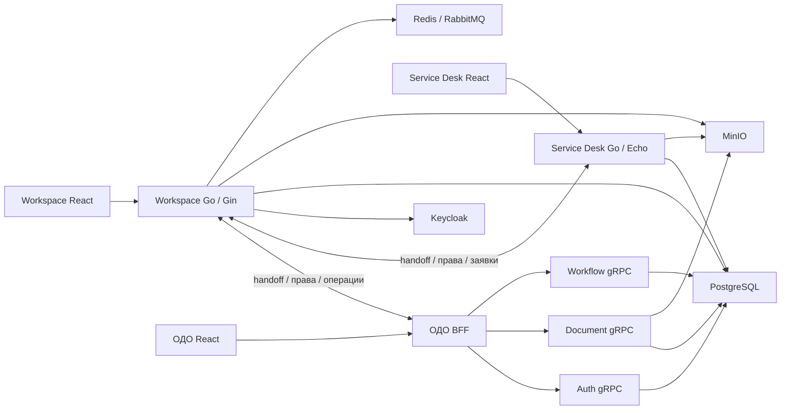

# Анализ Belesai / Workspace — 30 октября 2026

## Вывод

В рабочей папке находится экосистема из трёх продуктов и шести основных Git-репозиториев. Код всех трёх Go-бэкендов проходит обычные тесты и vet; все три React-фронтенда проходят TypeScript и lint. При этом в Workspace сохраняются публичные операции над данными без авторизации, в Service Desk есть опасные настройки аутентификации и открытая регистрация в компанию, а контрактная проверка ОДО не проходит. Успех тестов не является подтверждением безопасности или готовности полного интегрированного релиза.

Анализ охватывает структуру, ключевые потоки доступа, хранение, интеграции, тесты, CI и запуск. Это обзор всех репозиториев с углублённой проверкой отдельных критических цепочек, а не построчная проверка каждого файла. Production, внешние сервисы и действующая схема БД не проверялись. Отчёт от 21 октября использован как список гипотез, а не как источник автоматически актуальных дефектов.

## Зафиксированное состояние

| Репозиторий | Ветка / HEAD | Назначение |
| --- | --- | --- |
| axis_workspace/workspace-backend | ansar-branch / cfe698a | Центральный корпоративный API, пользователи, организации, мессенджер, Drive, Docs, задачи, AI |
| axis_workspace/workspace-front | main / 685cb31 | React-интерфейс Workspace |
| odo/workspace-odo-backend | main / acfb8ae | Документооборот, согласование, подпись, архив, AI |
| odo/workspace-odo-front | main / 4741920 | React-интерфейс ОДО |
| senim_desk/workspace-sd-backend | main / 4fa5828 | Service Desk, заявки, оборудование, сотрудники, компании, RBAC |
| senim_desk/workspace-sd-front | main / a41ffde | React-интерфейс Service Desk |

На начало анализа Workspace backend чистый, 279 коммитов ahead относительно локального origin/ansar-branch. Это включает merge из main, а не означает 279 новых собственных изменений. Сетевой fetch не выполнялся; актуальность remote refs не установлена. Остальные основные деревья чистые, кроме существующего изменения .env в sd-front. Резервные копии в backups не являются активными продуктами и не менялись.

## Архитектура

Workspace — крупный модульный монолит: router → middleware → handler → service → repository. Зависимости собираются вручную в cmd/api/main.go. PostgreSQL хранит данные и часть фоновых очередей; MinIO — файлы; Keycloak — идентификацию; присутствуют Redis, RabbitMQ, ONLYOFFICE, LiveKit, SMTP, LDAP/AD и AI-провайдеры. Централизация пользователей и прав делает Workspace критической зависимостью других продуктов.

ОДО разделён на BFF, auth, document и workflow процессы с отдельными логическими БД. Однако BFF сам открывает хранилища auth/document/workflow и содержит значительную бизнес-логику. Граница сервисов частично размыта: изменение схемы может требовать согласованного выпуска BFF и сервисов. gRPC доверяет переданному scope через metadata; защита внутренней сети является частью модели безопасности.

Service Desk — монолит на Echo, usecase/domain/repository, PostgreSQL через GORM/pgx. Есть tenant middleware, host guard, RBAC, проверки доступа к заявкам/объектам и интеграция централизованных прав Workspace. Наличие общей middleware не доказывает корректность каждого отдельного SQL-запроса.

Все фронтенды используют React 19, TypeScript и Vite. Workspace разделён на domain/application/infrastructure/presentation; SD организован вокруг features/shared/pages; ОДО содержит большие централизованные компоненты и API-модуль. В Workspace и ОДО имеются очень похожие большие реализации мессенджера: исправления нужно синхронизировать либо выделить поддерживаемый общий пакет.

## Масштаб и сопровождаемость

Подсчёт по git ls-files, без docs/docs.go и сгенерированных protobuf Go-файлов:

| Backend | Go-файлы приложения | Строки приложения | Файлы Go-тестов | SQL-файлы |
| --- | ---: | ---: | ---: | ---: |
| Workspace | 706 | 180 061 | 501 | 264 |
| ОДО | 160 | 51 699 | 114 | 74 |
| SD | 91 | 34 864 | 33 | 85 |

SQL-файлы — размер исходников, не количество применённых миграций. Число тестовых файлов не равно покрытию.

Крупные точки изменения: Workspace livekit_handler.go ~157 КБ, drive_service.go ~106 КБ, auth/service_keycloak.go ~101 КБ; ОДО contract_handler.go ~214 КБ; SD repository/postgres/repository.go ~135 КБ. На фронтендах MessengerPageContent.tsx достигает ~569 КБ в Workspace и ~534 КБ в ОДО; DocumentDetails.tsx ~268 КБ, CalendarPage.tsx ~269 КБ. Это увеличивает стоимость review, регрессий и согласования параллельной разработки. Выделять следует сценарии и политики доступа, а не только дробить файлы.

## Подтверждённые проблемы и условия

P1 — серьёзный риск для данных или аутентификации; P2 — надёжность, эксплуатация или качество выпуска. Приоритеты условных сценариев зависят от реальной конфигурации.

### A01 · P1 · Публичное физическое удаление файлов Workspace

internal/server/router.go:242 регистрирует DELETE /api/v1/files/public вне защищённой группы. internal/handler/file_handler.go:299 принимает object_name и вызывает DeleteFile; internal/service/file_service.go удаляет объект MinIO без проверки владельца, ACL или публичного префикса. При известном ключе чужой объект можно удалить, обходя Drive и корзину. Проверено по коду, запросы удаления не выполнялись. Исправление: удаление через ресурс и его права; анонимный маршрут закрыть.

### A02 · P1 · Подпись произвольного object key без ACL

internal/handler/file_handler.go:102 передаёт object_name в FileService.GetFileURL без ID пользователя. internal/service/file_service.go:213 непосредственно формирует signed URL. Авторизованному пользователю достаточно знать чужой ключ. Наличие отдельной функции проверки доступа в FileService не защищает этот путь, поскольку GetFileURL её не вызывает. Исправление: авторизация ресурса, версии и состояния удаления до подписи; тест на пользователя другой компании.

### A03 · P1 · Открытые административные и пользовательские операции Workspace

В internal/server/router.go:294–301 публично зарегистрированы входящие уведомления, email logs и управление email mappings; на строке 360 — auth/sync-keycloak; на строке 350 — обновление аватара. SyncUsersWithKeycloak в auth_handler.go:3064 сразу вызывает привилегированный сервис. UpdateUserAvatar на строке 1831 использует переданный user_id без определения инициатора. Маршруты должны получить отдельную аутентификацию и авторизацию; webhook — проверку источника и защиту повторов. Публичный sync особенно опасен из-за административного доступа к Keycloak. Применимость ограничений reverse proxy не установлена.

### A04 · Высокий условный риск · Автоматическая перепривязка SSO-идентичности

internal/repository/user_repository.go:1402 ищет локального кандидата через findKeycloakMatchCandidate; persistLinkedKeycloakUser:693 проверяет активность, затем syncKeycloakIdentityFields:656 заменяет KeycloakID входящим значением. Защиты уже связанного subject здесь нет. Возможность атаки зависит от того, может ли недоверенный субъект контролировать совпадающий ИИН/email/login в принятом SSO-токене. Из одного этого кода нельзя объявлять доказанным публичный захват аккаунта.

Важное изменение относительно старого аудита: handler Register в internal/handler/auth_handler.go:319 всегда отвечает 403 invitation required. Поэтому старая цепочка публичная регистрация → чужой ИИН → захват аккаунта сейчас через этот endpoint не работает. Самостоятельное вступление в компанию через старый Workspace register также закрыто. Сервис Register остаётся в коде, но доступность его старой HTTP-цепочки опровергнута. Нужен отдельный аудит всех действующих SSO/linking вызовов и политики изменения атрибутов в Keycloak.

### A05 · P1 при пустом JWT_SECRET · Известный резервный ключ SD

senim_desk/workspace-sd-backend/internal/usecase/auth.go:35 при отсутствии JWT_SECRET использует постоянный ключ из исходников. ValidateToken:365 доверяет подписанным claims роли и компании. При запуске без корректной переменной подпись токенов перестаёт быть секретом. Значение ключа намеренно не воспроизводится. Исправление: отказ старта при пустом/слабом секрете и проверка production-конфигурации.

### A06 · P1 · Публичная регистрация SD принимает company_id

SD router.go публично регистрирует POST /auth/register. AuthHandler.Register:93 принимает company_id и присваивает его пользователю; при отсутствии выбирает default company. Проверка ManagedByWorkspace зависит от request policy, но этот публичный маршрут не проходит api.Use(WorkspacePositionPolicy). По коду возможно создание записи, связанной с выбранной компанией, без приглашения. Конечный доступ зависит от статуса учётки, membership и дальнейших проверок: доступ ко всем данным компании этим анализом не доказан. Исправление: приглашения либо авторизованное создание сотрудников; проверить регистрацию, активацию, login и контекст компании одним интеграционным сценарием.

### A07 · P2 · В SD проверка JWT не проверяет актуальность пользователя

AuthUseCase.ValidateToken:365 разбирает подпись и claims, но не читает текущую активность/удаление пользователя и компании. Проверка активности присутствует в других путях, поэтому это не утверждение об отсутствии блокировки во всём SD. При обязательной интеграции Workspace часть запросов получает дополнительную политику, однако standalone режим и маршруты вне неё требуют проверки. Старые access tokens могут сохранять права до истечения срока. Требуются явная семантика отзыва и тест блокировки уже выданного токена.

### A08 · P2 · Контракт ОДО не проходит

odo/workspace-odo-front/scripts/check-api-contract.mjs:8 по умолчанию ищет ../documentolog, тогда как checkout называется workspace-odo-backend. npm run check падает с ENOENT после успешного lint. С BACKEND_OPENAPI_PATH на фактический swagger проверка также падает: множество вызовов frontend отсутствуют в OpenAPI. Это подтверждает несогласованность контракта/проверки, но не доказывает отсутствие работающих handlers: среди них есть custom и проксируемые AI endpoints. Нужны верный путь, полный контракт custom/proxy API и проверка в CI. Localization/security checks при отдельном запуске успешны.

### A09 · P2 · Ложная готовность и повторные миграции Workspace

internal/server/router.go:1419 возвращает ready без проверки PostgreSQL. В cmd/api/main.go:127 goose.Up вызывается при каждом старте; docker/entrypoint.sh перед API также запускает отдельный migrator. Это две точки миграции, требующие согласования при масштабировании. Падение PostgreSQL может не отражаться в readiness. Нужны bounded readiness checks, один владелец миграций и отдельная готовность worker.

### A10 · P2 · Неполные гарантии доставки и широкие блокировки

cmd/api/main.go:83 при невозможности инициализировать RabbitMQ продолжает работу с noop publisher. Для событий, от которых зависит интеграция, нужен явно согласованный режим отказа и durable outbox/retry. Существование outbox в отдельных модулях не распространяет гарантию на все публикации.

internal/repository/contact_offboarding_repository.go:59–62 берёт общий advisory lock и SHARE ROW EXCLUSIVE на восемь таблиц. Это обеспечивает сериализацию, но может задержать записи других организаций при большом offboarding. Производительность и длительность блокировок не измерены; необходим нагрузочный сценарий до изменения механизма.

### A11 · P2 · Доверенная сеть ОДО и HTTP-ограничения

cmd/bff-gateway/main.go использует insecure gRPC transport, а document-service создаёт grpc.Server без аутентифицирующего interceptor. pkg/access/scope.go читает user/organization/permission metadata. Прямой доступ к внутреннему порту должен считаться привилегированным. В просмотренных Compose gRPC-порты expose, без публикации на хост; публичный обход не подтверждён. Для менее доверенной сети нужны service authentication/mTLS и сетевые ограничения.

BFF http.Server в cmd/bff-gateway/main.go:145 не задаёт ReadHeaderTimeout, ReadTimeout, WriteTimeout и IdleTimeout. Ограничения reverse proxy не проверены. Их следует настроить с учётом upload/streaming, а shutdown сделать управляемым.

## Что уже улучшено и что следует сохранить

- Публичная регистрация Workspace закрыта, есть приглашения с подтверждением email.
- CreateUser использует CheckNewUserIdentity/CreateNewUser, а не linking upsert. user_account_creation.go содержит insert-only путь, проверку коллизий и сортированные advisory locks. Есть интеграционные проверки сохранения владельца и конкурирующего создания. Старую перезапись директора этим путём нельзя считать актуальным дефектом без нового воспроизведения.
- Новые Drive/Docs содержат версии, ACL, callback receipts, ограничения квот и сценарии конфликтов; защищённые API нельзя заменять legacy файловыми endpoint.
- ОДО middleware сначала валидирует JWT через auth service, затем читает дополнительные claims. ParseUnverified здесь используется после проверки того же токена; это само по себе не обход подписи. Аналогичная последовательность есть в SD middleware.
- SD содержит tenant/host guard, RBAC и object/ticket access middleware. Их нужно расширять проверками межкомпанейного доступа и фоновых сценариев.
- Старое падение Workspace go vet на копировании sync.Map сейчас не воспроизводится. GitHub CI запускает реальные тесты с PostgreSQL/MinIO, deployment safety и converters. GitLab job по-прежнему использует -run '^$' и проверяет компиляцию вместо выполнения тестов.

## Выполненные проверки

Go test запускался обычным способом, без -count=1: Go мог использовать кэш. Числа top-level не включают subtests; пропуски не считаются успешным выполнением интеграции.

| Проверка | Результат |
| --- | --- |
| Workspace go test -json ./... | exit 0; 1270 top-level pass, 214 skip; с subtests 2303 pass / 307 skip |
| ОДО go test -json ./... | exit 0; 443 top-level pass, 35 skip; с subtests 636 pass / 90 skip |
| SD go test -json ./... | exit 0; 102 top-level pass, 2 skip; с subtests 121 pass / 2 skip |
| go vet ./... во всех трёх backend | exit 0 |
| TypeScript всех трёх frontend | exit 0 |
| ESLint всех трёх frontend | exit 0 |
| Vite production bundle всех трёх frontend | exit 0 |
| ОДО Vitest | 20 файлов, 72 теста прошли |
| ОДО npm run check | exit 1 на пути OpenAPI |
| ОДО api-contract-check с правильным BACKEND_OPENAPI_PATH | exit 1: отсутствующие в Swagger операции |
| ОДО localization-check / security-check | exit 0 / exit 0 |

Первый sandbox-запуск Go имел ошибки доступа к кэшу и запрет локальных httptest listeners. Результаты таблицы получены повторным запуском с необходимыми разрешениями; ошибки sandbox не классифицированы как дефекты приложения. Сырые журналы: /private/tmp/belesai-audit-*.log; временное хранение не гарантирует доступность в будущих сессиях.

Workspace bundle содержит index ~3,19 МБ (gzip ~816 КБ), mermaid vendor ~2,89 МБ (gzip ~788 КБ); ОДО index ~1,61 МБ (gzip ~408 КБ). Это размеры отдельных chunks, не измерение начального трафика: часть может загружаться лениво. Нужны browser network/performance и распределение по маршрутам. Vite также предупреждает о direct eval внутри ExcelJS; наличие предупреждения само по себе не доказывает эксплуатацию. SD использует заметно более дробные chunks.

В package.json Workspace нет общего unit-test script, хотя отдельные тестовые файлы и специальные проверки присутствуют; в SD frontend не обнаружены стандартные test/spec TS-файлы и нет test script. ОДО имеет действующий Vitest-набор. Для клиентских прав, SSO/handoff и восстановления состояния нужны содержательные пользовательские тесты.

## Сквозные процессы и выпуск

Приём сотрудника связывает iForm → ОДО → Workspace → SD. Документация фиксирует ожидание completed и завершённого маршрута, создание сотрудника перед SD и допуск с даты выхода. onboarding-release-acceptance.md описывает подготовленный локальный пакет, но прямо исключает реальный общий стенд с ЭЦП/SSO/MinIO и production-публикацию. Это исторический документ, его прогоны в этом анализе не повторялись. Исходники отдельного iForm-проекта в шести активных репозиториях не охвачены.

Риски интеграции: отмена после внешнего side effect, изменение даты выхода, повторные запросы и доставка статусов, несовпадение идентичностей/компаний между системами. Для каждого нужны idempotency key, сохранённая квитанция, retry policy и понятная компенсация. Доказать отсутствие компенсации во всех продуктах данным обзором нельзя.

Локальный запуск управляется корневым docker-compose.local.yml и scripts/local-dev.mjs, который делегирует backend-скрипту. Общая инфраструктура частично существует отдельно от Compose; новый checkout сам по себе не воспроизводит весь стенд. Опубликованные локальные порты не ограничены loopback. Конфигурация содержит значения для разработки: перед использованием на общем хосте требуются отдельные секреты и сетевые ограничения; значения секретов в отчёт не перенесены.

Токены Workspace и SD сохраняются в localStorage, ОДО использует также sessionStorage для OIDC. Это усиливает последствия XSS, но обнаруженной XSS в этом анализе нет. Нужны единая политика хранения/очистки сессий, CSP и проверка всех HTML/rendering поверхностей.

## Приоритетный план

1. Закрыть публичные destructive/admin endpoints Workspace и регистрацию в компанию SD; добавить проверку отсутствия JWT и доступа другой компании. Убрать резервный JWT secret с отказом старта.
2. Зафиксировать единую политику linking: подтверждённый subject, запрет незаметной замены связи, контролируемая миграция идентичности. Проверить все SSO-входы и восстановление доступа.
3. Восстановить контрактную проверку ОДО, описать custom/proxy API и сделать проверку обязательной при изменении frontend/backend.
4. Прогнать fresh install/upgrade на одноразовых PostgreSQL, интеграцию MinIO/Keycloak/ONLYOFFICE и полный onboarding E2E на отдельном стенде. Протестировать отмену/повторы/перенос даты и отзыв access tokens.
5. Уточнить readiness, миграции, retry/outbox, health worker и поведение при отказах зависимостей. Проверить backup restore и совместимость rollback схемы/образа.
6. Измерить p95/p99, SQL и блокировки на объёме, затем декомпозировать большие сценарии и дублирующийся мессенджер. До измерений оценивать ёмкость в пользователях или SLA нельзя.

## Границы достоверности

Не выполнены новый vulnerability scan, проверка текущих advisories, race detector, измерение coverage, полный migration smoke, нагрузка, restore drill и live E2E. Данные об уязвимостях зависимостей из аудита 21 октября не пересчитаны и не представлены как актуальный результат. Не проверены production-конфигурация, branch protection и реальные CI runs. Исходники приложения не изменялись; отчёт не является разрешением на production-релиз.
