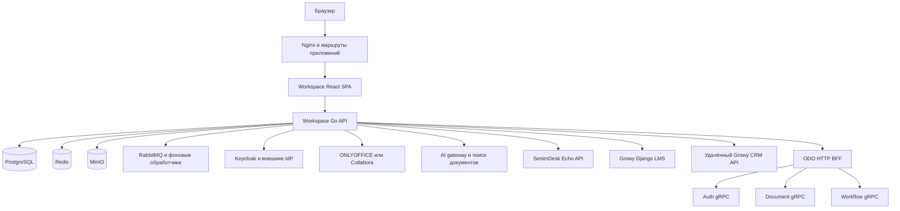

# Анализ Workspace и связанных продуктов

Дата: 5 ноября 2026 года. Объект проверки — локальные исходники восьми репозиториев в `/Users/ansar.keles/belesai`, с углублённой проверкой Workspace. Резервные копии в `backups/` не рассматриваются как действующий код.

Проект имеет развитую функциональность, слоистую архитектуру и значительное количество автоматических проверок. Однако в общих файловых API и панели мониторинга подтверждены серьёзные нарушения безопасности. Их следует устранить перед расширением функциональности. Успешный CI этих проблем не обнаруживает.

Проверка production от 4 ноября из `PROJECT_CONTEXT.md` используется только как историческое свидетельство. В ходе этого анализа production не проверялся и не изменялся. Состояние `origin/main` ниже — сохранённая локальная ссылка, без нового fetch. Уязвимые файловые функции, панель мониторинга, middleware логирования, WebSocket Origin и cookie-политика совпадают с этой версией main.

## Репозитории и версии

В рабочей папке восемь независимых Git-репозиториев и 5353 отслеживаемых файла. Общего репозитория или единого lock-файла нет.

| Продукт | Репозиторий | Ветка и коммит | Основа |
| --- | --- | --- | --- |
| Workspace | `axis_workspace/workspace-backend` | `ansar-branch`, `d3fdbf7` | Go, Gin, pgx, PostgreSQL |
| Workspace | `axis_workspace/workspace-front` | `ansar-branch`, `5b24546` | React 19, TypeScript, Vite 8 |
| Growy | `growy/workspace-growy-backend` | `ops/growy-crm-diagnostics`, `df9d86e` | Django 5.1.6, DRF, Channels |
| Growy | `growy/workspace-growy-front` | `main`, `a816b1d` | React 18, TypeScript, Vite 7 |
| SenimDesk | `senim_desk/workspace-sd-backend` | `main`, `cbd5690` | Go, Echo, GORM, PostgreSQL |
| SenimDesk | `senim_desk/workspace-sd-front` | `main`, `7740586` | React 19, React Query, Zustand |
| ODO | `odo/workspace-odo-backend` | `main`, `acfb8ae` | Go, HTTP BFF, gRPC-сервисы |
| ODO | `odo/workspace-odo-front` | `main`, `4741920` | React 19, TypeScript, Vite 8 |

До анализа деревья были чистыми, кроме уже изменённого `.env` SenimDesk frontend. Этот файл не редактировался. В SenimDesk backend/frontend `.env` отслеживаются Git; в backend обнаружены примерные локальные реквизиты, действительность секретов не проверялась. Для дальнейшей разработки предпочтительны `.env.example` и неотслеживаемые настройки окружения.

Workspace backend расходится с сохранённым `origin/main` `b12f659`: 25 коммитов только в текущей ветке и 27 только в main. Часть Contacts-функциональности текущей ветки отсутствует в main. Оценку ветки нельзя переносить на production целиком.

## Архитектура

Workspace backend — модульный монолит с разделением `handler → service → repository → PostgreSQL`, доменными типами и отдельными middleware. Он объединяет организационную структуру, доступы компаний, контакты, чат и WebSocket, канбан, календарь, файлы, документы, заметки, публикации и AI. Некоторые фоновые задачи выделены в отдельные процессы, включая обработку AI-документов.

Frontend разделён на `domain`, `application`, `infrastructure`, `presentation` и `shared`, но содержит крупные унаследованные компоненты и встроенные приложения. Мессенджер Workspace занимает 13883 строки в одном компоненте; календарь — 6280 строк. В ODO присутствует отдельная копия крупного мессенджера. Изменения таких областей требуют самостоятельной регрессии каждого приложения.

SSO и бизнес-доступы связаны, но являются разными проверками. Сначала определяется доступ компании/сотрудника к модулю, затем выполняются provisioning, handoff или обмен сессии, после чего действует авторизация удалённого продукта. Каталог модулей содержит `crm`, `growy`, `iform`, `odo`, `sd`. CRM и LMS используют разные API и отдельные настройки подключения; наличие Growy LMS-кода в папке не означает наличие исходников удалённого CRM.

Сильные стороны: транзакции и ограничения PostgreSQL, проверки компаний и объектных ACL в специализированных модулях, контроль ревизий, идемпотентность, outbox, ограничения и учёт AI-операций, проверки развёртывания и ресурсов CI. Основной архитектурный разрыв — старые общие файловые и служебные API обходят более строгие правила новых модулей.

## Подтверждённые проблемы безопасности

Приоритет P1 означает необходимость первоочередного исправления. P2 — следующий этап. Воспроизведения использовали синтетические данные, тестовые JWT и HTTP-имитацию MinIO; рабочие файлы и реальные аккаунты не использовались.

### 1. P1 Публичное удаление произвольного объекта без входа

`DELETE /api/v1/files/public?object_name=...` зарегистрирован вне защищённой группы. `DeletePublicFile` передаёт указанное имя в `FileService.DeleteFile`, который вызывает `RemoveObject` без проверки пользователя, владельца, компании или префикса публичного объекта.

При известном имени объекта удаление доступно без авторизации, включая объект с приватным путём. Удаляется объект в хранилище; согласованного изменения Drive-метаданных, квот и истории этот путь не обеспечивает. Название маршрута «public» не ограничивает фактическую область удаления.

Локальное воспроизведение: анонимный запрос вернул 200 и отправил DELETE приватного синтетического объекта в имитацию MinIO. Код совпадает с сохранённым main.

Источники: [регистрация маршрутов](../internal/server/router.go), строки 239–242; [DeletePublicFile](../internal/handler/file_handler.go), строка 294; [DeleteFile](../internal/service/file_service.go), строка 325.

Исправление: закрыть этот маршрут для произвольных объектов; публичную загрузку и удаление при необходимости привязать к ограниченной серверной capability. Удаление рабочих файлов выполнять через доменную операцию с ACL, метаданными, версиями и аудитом.

### 2. P1 Выдача подписанной ссылки и удаление без объектных ACL

`GET /api/v1/files/url` требует входа, но не проверяет право пользователя на переданный `object_name`. `GetFileURL` сразу подписывает имя. Download с корректной подписью затем обслуживается без повторной пользовательской проверки — это допустимо для ограниченной ссылки, но её выдача должна быть авторизована.

Защищённый `DELETE /api/v1/files` также вызывает удаление без объектной проверки. Дополнительно `ValidateUserAccessToObject` возвращает успех, если объект не найден в Drive или получение записи не удалось; для вложений вне Drive полноценной проверки доступа нет.

Локальное воспроизведение: пользователь 900001 получил действительную ссылку на синтетический объект `documents/424242/private-fixture.pdf`, анонимно скачал его по этой ссылке и отправил удаление. БД и реальное хранилище в воспроизведении не использовались. Код совпадает с сохранённым main.

Источники: [GetFileURL и DeleteFile](../internal/handler/file_handler.go), строки 102 и 200; [подписание и проверка доступа](../internal/service/file_service.go), строки 212–268.

Исправление: единая проверка ACL до выдачи URL и до удаления; неизвестный объект или ошибка проверки должны приводить к отказу. Для чатов, заметок и прочих вложений проверять доступ к родительскому ресурсу.

### 3. P1 Выполнение JavaScript через панель API-мониторинга

`Origin`, `Referer`, `User-Agent` и путь запроса поступают в общий API tracker. Панель вставляет их в `innerHTML` без HTML-экранирования. Для внедрения записи достаточно запроса к обычному маршруту, включая `/health`. CSP самой панели разрешает inline JavaScript.

Подтверждение: в отдельном headless Chrome неизменённый HTML панели с её CSP выполнил безопасный JavaScript-маркер из синтетического `Referer`. Последствия зависят от прав человека, открывшего панель; код выполняется в origin приложения.

Источники: [APITracking](../internal/middleware/common.go), строка 19; [отрисовка панели](../internal/handler/api_monitoring_handler.go), строки 238–285.

Исправление: создавать DOM-узлы с `textContent`, убрать inline-обработчики и разрешение `unsafe-inline`, добавить регрессию на вредоносные строки HTTP-заголовков.

### 4. P1 Общая телеметрия доступна без административной роли

`/api/admin/monitoring` и `/stats` проверяют только валидность локального JWT через `AuthMiddleware.Authenticate`. Проверки роли администратора и фильтра компании нет. Статистика содержит общие IP-адреса, URL, Referer и User-Agent запросов разных пользователей.

Подтверждение: обычный синтетический локальный JWT получил HTTP 200 и данные другого запроса. Это утверждение относится к локальным JWT; поведение Keycloak-only токенов может отличаться.

Источники: [router](../internal/server/router.go), строки 132–137; [GetStats](../internal/handler/api_monitoring_handler.go), строка 23.

Исправление: явный доступ платформенного администратора из актуального состояния БД и отдельная политика для общей и корпоративной телеметрии. Аналогично проверить назначение `/metrics`.

### 5. P1 Недостаточная защита cookie-аутентификации от чужого Origin

Для HTTPS access/refresh cookies выставляются с `SameSite=None`. Middleware принимает access cookie, но общего CSRF-токена или запрета чужого Origin для записывающих операций нет. CORS ограничивает чтение ответов браузером и сам по себе не запрещает выполнение запроса. Обработчики с `ShouldBindJSON`, например создание заметки, принимают JSON независимо от заявленного `Content-Type`.

Оба WebSocket upgrader — мессенджера и whiteboard — возвращают `true` из `CheckOrigin`. Это создаёт аналогичную проблему для соединений с cookie-аутентификацией.

Локально общий стек middleware пропустил синтетический POST с чужим Origin, cookie и `text/plain` JSON. Реальные бизнес-операции не выполнялись. Практическая эксплуатация зависит в том числе от отправки cookies браузером и его политики сторонних cookies.

Источники: [cookies](../internal/handler/auth_cookies.go), строка 113; [извлечение токена](../internal/middleware/auth.go), строка 129; [создание заметки](../internal/handler/note_handler.go), строка 55; [WebSocket](../internal/handler/websocket_handler.go), строка 19; [whiteboard](../internal/handler/whiteboard_handler.go), строка 21.

Исправление: согласованная защита Origin/CSRF для cookie-запросов и allowlist Origin при WebSocket handshake. Сохранить необходимые сценарии SSO и embedded-приложений; изменение одного SameSite без проверки интеграций может их нарушить.

### 6. P1 Токены из URL попадают в журналы

Logger сохраняет `RawQuery` без редактирования. Аутентификация принимает `token` и `access_token` из query; такие URL используются также для документов и callback-потоков. В журнал могут попадать bearer-токены, OAuth-коды и другие ограниченные ссылки.

Подтверждение: observer логгера сохранил синтетические `token` и `code` без маскирования. Реальные секреты не извлекались.

Источники: [Logger](../internal/middleware/common.go), строки 65–76; [ExtractToken](../internal/middleware/auth.go), строки 140–145; [Keycloak extraction](../internal/middleware/keycloak_auth.go).

Исправление: allowlist безопасных query-полей либо централизованное удаление чувствительных параметров; для WebSocket предпочтительны одноразовые короткие tickets. Проверить аналогичное логирование reverse proxy.

### 7. P1 Вход по паролю и PIN не подключён к общему rate limiter

При включённом `RATE_LIMIT_ENABLED` limiter применяется к защищённым маршрутам и `login-options`, но не к `POST /auth/login` и `POST /auth/pin/login-by-pin`. В `QuickPinService.LoginByPin` после неправильного PIN нет счётчика неудач или временной блокировки. Проверка blocked-device не заменяет ограничение перебора. PIN-сценарий дополнительно требует известный идентификатор устройства.

Источники: [маршруты входа](../internal/server/router.go), строки 330 и 352; [проверка PIN](../internal/auth/quick_pin_service.go), строка 239. Защита конкретной конфигурации Keycloak и reverse proxy отдельно не проверялась.

Исправление: отдельные ограничения по IP, аккаунту и устройству с тестами неправильных попыток и последующего восстановления доступа.

## Надёжность и эксплуатация

| Приоритет | Наблюдение | Последствие и действие |
| --- | --- | --- |
| P2 | Tracker ограничивает только 200 последних логов; maps путей, источников и User-Agent не очищаются | Неограниченная кардинальность от неавторизованных запросов. `GetStats` сортирует накопленные записи двойными циклами под RLock. Ввести TTL/лимиты, шаблоны маршрутов и эффективный top-k. Источник: `internal/telemetry/tracker.go`. |
| P2 | `/ready` всегда возвращает 200 | Недоступность БД после старта не отражается в readiness. Добавить ограниченный по времени Ping БД и только обязательные зависимости. Источник: `internal/server/router.go:1419`. |
| P2 | Cisco scheduler и путь smart-agent используют `InsecureSkipVerify: true` | Проверка подлинности TLS-сервера отключена. Настроить доверенный CA и имя сервера. Источники: `internal/service/calendar_meeting_provider_service.go:333`, `smart_agent_tools.go:647`. |
| P2 | Growy включает `CORS_ALLOW_ALL_ORIGINS=True` вместе с credentials без привязки к DEBUG | Заданный allowlist не ограничивает CORS. Применить явные доверенные origins; наличие эксплуатации не проверялось. Источник: `growy/.../config/settings.py:72`. |
| P2 | Конструктор FileService выставляет публичную bucket policy для `ai-uploads/*` | Это предусмотренное кодом поведение, но вложения AI доступны по постоянному известному пути без пользовательской ACL. Для конфиденциальных вложений заменить на короткие подписанные ссылки и согласовать политику хранения. |
| P2 | Локальная инфраструктура зависит от заранее существующих контейнеров | Launcher запускает существующие БД/Keycloak/MinIO; создание среды с нуля полностью не описано одной воспроизводимой процедурой. Growy CRM и его SSO локально отдельно не настроены. |

Production Compose содержит полезные ограничения: API опубликован на loopback, инфраструктура проверяется healthcheck, настроена ротация Docker-логов, AI document worker отделён от API. В CI имеются проверки безопасного развёртывания и управления ресурсами. Эти меры следует сохранить при исправлениях.

## Зависимости

Свежий `npm audit --package-lock-only` дал следующие результаты. Числа относятся к записям зависимостей каждого lock-файла, включая транзитивные и dev-зависимости. Они не являются числом уникальных CVE или доказанных способов атаки на production.

| Frontend | Low | Moderate | High | Critical | Всего |
| --- | ---: | ---: | ---: | ---: | ---: |
| Workspace | 4 | 11 | 17 | 0 | 32 |
| Growy | 5 | 12 | 19 | 0 | 36 |
| SenimDesk | 2 | 3 | 17 | 0 | 22 |
| ODO | 0 | 13 | 11 | 0 | 24 |

Итого по четырём графам — 114 записей, из них 64 High; одинаковые зависимости могут учитываться в нескольких продуктах. Среди прямых пакетов с итоговой оценкой High есть axios, react-router-dom, Vite; в отдельных продуктах — DOMPurify, Zod и другие. Применимость каждой advisory требует проверки используемого API и браузерного/серверного контекста.

Примеры условий из первичных источников: [axios advisory](https://github.com/axios/axios/security/advisories/GHSA-xj6q-8x83-jv6g) описывает предпосылку уже существующего prototype pollution; [DOMPurify advisory](https://github.com/cure53/DOMPurify/security/advisories/GHSA-hpcv-96wg-7vj8) относится к определённому cross-realm `IN_PLACE` сценарию. Их наличие в графе само по себе не подтверждает такой сценарий в приложении. `npm audit fix --force` не запускался; для pptxgenjs автоматическое предложение включает изменение версии с пометкой semver-major и требует отдельной проверки.

Growy backend фиксирует Django 5.1.6. Серия 5.1 завершила extended support 3 декабря 2025 года и больше не получает исправлений безопасности — [официальный список Django](https://www.djangoproject.com/download/). Требуется переход на поддерживаемую серию с проверкой совместимости DRF, Channels и миграций. Есть и не полностью зафиксированные зависимости (`cryptography>=...`, `django-q2>=...`, `drf-spectacular`), поэтому повторная сборка не гарантирует одинаковый Python-граф.

Полный vulnerability scan Go-модулей и Python-пакетов в этом анализе не выполнялся; вывод о безопасном состоянии этих графов не делается.

## Фактические результаты проверок

Числа Go ниже включают вложенные subtests. Проверки PostgreSQL выполнялись на отдельном PostgreSQL 15 с UTF-8 locale `en_US.UTF-8`; production CI использует PostgreSQL 16. Серверы тестовых БД остановлены. Падения из-за первоначальной песочницы и неподходящей C locale не включены в окончательные дефекты.

| Компонент | Результат |
| --- | --- |
| Workspace backend `ansar-branch`, без PostgreSQL | 2322 pass, 312 skip, без падений |
| Workspace backend `ansar-branch`, с PostgreSQL | 2729 pass, 19 skip, 6 fail-событий в пяти верхнеуровневых тестах |
| Workspace backend, отдельная копия сохранённого `origin/main b12f659`, с PostgreSQL | 2750 pass, 20 skip, без падений |
| SenimDesk backend с PostgreSQL | 125 pass, без skip и падений |
| ODO backend с PostgreSQL и штатными workflow-миграциями | 733 pass, без skip и падений |
| `go vet ./...` | Успешно во всех трёх Go-бэкендах |
| Workspace frontend | TypeScript, production bundle, i18n и браузерная проверка успешны; ESLint: 0 ошибок, 476 предупреждений; Node tests: 149 pass, 5 fail |
| Growy frontend | Сборка с TypeScript успешна; 50 тестов в 13 файлах прошли; ESLint: 0 ошибок, 659 предупреждений |
| SenimDesk frontend | TypeScript/сборка и ESLint успешны; предупреждений линтера нет; отдельного набора frontend-тестов не обнаружено |
| ODO frontend | Сборка, ESLint и 72 теста в 20 файлах успешны; отдельные localization/security checks прошли; проверка API-контракта не прошла |
| Growy backend | 429 Python-файлов успешно разобраны AST, найдено 660 test-методов; Django-тесты не запускались |
| Workspace CI safeguards | 105 тестов, из них 11 skip; ошибок нет |

Для Growy frontend установлены зависимости из существующего lock-файла с отключёнными install-скриптами. Исходники и lock-файл не менялись. Для браузерной проверки Workspace использован отдельный headless системный Chrome вместо отсутствующего Playwright Chromium; проверены вход, восстановление, неверные ссылки, desktop/mobile invitation scrolling, клавиатурный доступ, referrer и Origin после SPA-перехода. Авторизованные бизнес-сценарии этим тестом не покрываются.

### Падения тестов ansar-branch

1. `TestOrganizationAdministrationLifecycle/module_administration`: ожидает четыре модуля вместо пяти. В сохранённом main уже исправлено.
2. `TestContactsIntegration`: ожидание `organization not found` расходится с фактическим `administrator required`.
3. `TestContactProfileIntegration`: fixture не создаёт `organization_admin_audit`.
4. `TestOrganizationTreeIntegration`: аналогично отсутствует `organization_admin_audit`.
5. `TestDocumentCreationAndTemplatesIntegration`: fixture повторно создаёт существующую `organizations`.

Это подтверждённые проблемы набора проверок ветки. Ошибки отсутствующих таблиц возникают в сокращённых тестовых схемах и не доказывают отсутствие таблиц на production. Поиск канбана с корректной UTF-8 locale прошёл, включая 20003 видимые задачи; его первоначальное падение было связано с тестовым окружением.

### Неполная регрессия Telegram и контракт ODO

Пять Node-тестов Workspace Telegram падают на открытии forum topics, изображении при расширении истории, resync после reconnect, realtime merge и переключении phone login на QR. Среди причин — несоответствие DOM/mock-интерфейса и текущего `inbox.js`, в том числе отсутствующий `GrowyTelegramBindReply`. Без браузерного воспроизведения нельзя объявлять все пять отдельными пользовательскими дефектами. Telegram-тесты не включены в явный список Node-тестов текущего frontend CI, поэтому pipeline может оставаться зелёным.

`npm run check` ODO frontend по умолчанию ищет Swagger в несуществующем соседнем `../documentolog`. С `BACKEND_OPENAPI_PATH=../workspace-odo-backend/internal/bff/handler/docs/documentolog.swagger.json` проверка доходит до сравнения и находит 119 отсутствующих соответствий. Это рассинхронизация проверки/спецификации и вызовов; она не доказывает, что все соответствующие runtime endpoints отсутствуют. Нужны корректный путь, актуальная OpenAPI и контрактная проверка в CI.

## Пользовательские интеграции

По production-проверке от 4 ноября остаются два ранее подтверждённых вопроса:

- CRM: доступ компании включён, но обмен с удалённым Growy CRM возвращал 409 `external_identity_conflict`. Требуется подтверждённая привязка существующего удалённого аккаунта. Включение карточки CRM не исправляет конфликт identity. Во время текущего анализа production-статус не обновлялся.
- SenimDesk: API отдавал директору заявки и проекты, а Kanban UI показывал пустую выборку. Текущий `KanbanPage` выбирает ветку загрузки по primary `role`/`is_tenant_root`; `hasPermission` используется для создания, но не обеспечивает такую же модель чтения проектов. При пустом наборе проектов `useTickets` отключён, затем рисуется пустой список. Требуется проверять эффективные права чтения, включая `read_all`, и добавить регрессию для Workspace custom roles.

Локальный CRM ранее останавливался на отсутствующем ключе provisioning/SSO; это отдельная проблема конфигурации, не тот же production 409. Docker в начале текущего анализа был выключен и не запускался, поэтому вход под Анной и интегрированная UI-проверка сегодня не выполнялись.

## Производительность и сопровождение

Свежий HTML сборки Workspace подключает скрипт и modulepreload для 23 JS-ресурсов: около 10.95 MB до сжатия и 2.92 MB при отдельном gzip каждого файла. Это размер объявленных начальных JS-ресурсов, а не измерение реального трафика или Web Vitals. Главный bundle — 3.22 MB, Mermaid — 2.89 MB, причём Mermaid preloaded уже на входе. Перенести тяжёлые редакторы, диаграммы, экспорт Office и PDF на загрузку при открытии соответствующего раздела.

Крупные компоненты и обход типов затрудняют безопасные изменения. В Workspace 360 предупреждений `no-explicit-any`; в Growy — 308 таких предупреждений и 105 `exhaustive-deps`. Это долг сопровождения, а не доказательство 476 или 659 пользовательских ошибок. Рефакторинг целесообразно начинать с изменяемых границ и поведенческих тестов, постепенно разделяя состояние, API-адаптеры и представление.

При выкладке ветки отдельно согласовать историю миграций: ansar содержит `20261103000100_crm_company_module.sql`, а main — уже выпущенную `20261103173000_crm_company_module.sql`. В main также есть более поздние Meet-миграции. Прямая выкладка ветки без сверки с применённой схемой может остановиться на пропущенной миграции или дублировать уже выпущенную операцию. Политику строгого запрета неизвестных пропусков ослаблять не следует.

## Порядок доработки

1. Закрыть анонимное произвольное удаление и централизовать файловые ACL до подписи/скачивания/удаления. Добавить проверки чужой компании, неизвестного объекта, ошибки БД и сохранности версий.
2. Исправить XSS и административную авторизацию мониторинга, затем маскирование секретов в журналах.
3. Добавить защиту Origin/CSRF/WebSocket и ограничения неправильных password/PIN-попыток, сохранив SSO-сценарии.
4. Обновить зависимости по применимости, перевести Django на поддерживаемую серию, ограничить Growy CORS и включить проверку TLS.
5. Синхронизировать тесты ветки и миграции с main, включить Telegram-регрессию и исправить ODO-контракт.
6. Решить подтверждённую CRM-привязку и фильтрацию SenimDesk по эффективным правам, затем выполнить согласованный E2E с записью на тестовых данных.
7. Улучшить readiness, ограничить кардинальность telemetry, уменьшить первоначальную JS-загрузку и воспроизвести окружение с нуля.

Исходники приложения, настройки окружений, роли, привязки и production не менялись. Исправления, коммиты и push не выполнялись. Добавлен только этот отчёт; контекст беседы обновлён отдельно. Django runtime, реальные MinIO/Keycloak/DocumentServer, нагрузка production и полный авторизованный write-E2E остаются вне выполненной проверки.

Доказательства и воспроизводящие скрипты: `/private/tmp/belesai-audit-20261105-KJqVXO/`. Ключевые файлы: `security-proof-final.log`, `browser-proof.json`, `workspace-cached-main-tests.jsonl`, `workspace-postgres-utf8-tests.log`, `sd-postgres-utf8-tests.log`, `odo-postgres-utf8-tests.log`, `workspace-front-tests.log`, `*-npm-audit.json`. Временный каталог не является постоянным архивом отчёта.
