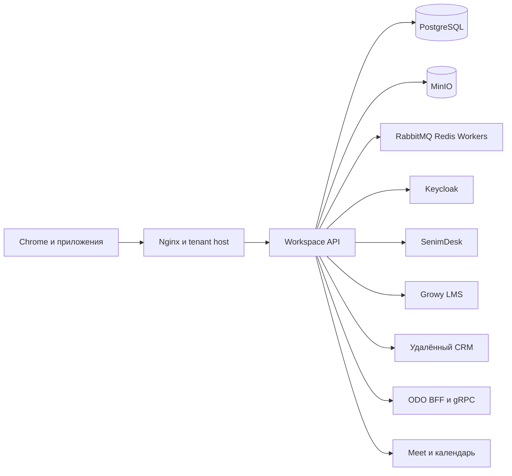

# Анализ проекта и production на 6 ноября 2026 года

Проверены восемь репозиториев Workspace, Growy, SenimDesk и ODO, свежие удалённые `main`, результаты их CI, статические зависимости Go/Python/JavaScript и production-интерфейсы в Chrome под директором Sultan Corp.

Главные результаты: ошибка пустого канбана SenimDesk воспроизведена на production сегодня; CRM продолжает блокировать доступ из-за необходимой привязки аккаунта; в ODO подтверждено расхождение счётчика просрочки и открываемого реестра. Прежние уязвимости общих файловых API Workspace остаются в актуальном main. Последние CI всех восьми репозиториев успешны, но не покрывают эти пользовательские сценарии и все найденные риски безопасности.

Этот отчёт уточняет [аудит от 5 ноября](project-audit-2026-11-05.md). Результаты прежних локальных тестов не выдаются за новые проверки. Локальные приложения и БД сегодня не запускались. Бизнес-данные, настройки, роли, документы, заявки, обучение и привязки production не изменялись; выполнялись штатный вход, чтение страниц и временные UI-фильтры.

## Состояние исходников и выкладок

Выполнен свежий `git fetch origin main` во всех восьми репозиториях. Рабочие ветки не переключались и не объединялись. Для анализа актуальных main созданы отдельные снимки исходников в `/private/tmp`.

| Репозиторий | Актуальный origin/main | Локальная ветка | Уникальные коммиты локально / в main | Последний CI main |
| --- | --- | --- | ---: | --- |
| Workspace backend | `36eee2c` | ansar-branch `d3fdbf7` | 25 / 37 | [success](https://github.com/west6ide/workspace-backend/actions/runs/42011458434) |
| Workspace frontend | `f6b3756` | ansar-branch `5b24546` | 1 / 17 | [success](https://github.com/west6ide/workspace-front/actions/runs/42018739295) |
| Growy backend | `2a8f575` | ops/growy-crm-diagnostics `df9d86e` | 4 / 0 | [success](https://github.com/west6ide/workspace-growy-backend/actions/runs/41409303297) |
| Growy frontend | `182585a` | main `a816b1d` | 0 / 1 | [success](https://github.com/west6ide/workspace-growy-front/actions/runs/42018801245) |
| SenimDesk backend | `3ea1aab` | main `cbd5690` | 0 / 1 | [success](https://github.com/west6ide/workspace-sd-backend/actions/runs/42018750535) |
| SenimDesk frontend | `7740586` | main `7740586` | 0 / 0 | [success](https://github.com/west6ide/workspace-sd-front/actions/runs/41424654821) |
| ODO backend | `9b981db` | main `acfb8ae` | 0 / 8 | [success](https://github.com/west6ide/workspace-odo-backend/actions/runs/42029424199) |
| ODO frontend | `c738a54` | main `4741920` | 0 / 41 | [success](https://github.com/west6ide/workspace-odo-front/actions/runs/42018776816) |

Прочитаны также статусы jobs и шагов последних runs: release jobs завершились успешно; отдельные checks jobs пропущены штатным условием запуска main. Успех pipeline подтверждает выполнение заданных в нём проверок, но не отсутствие ошибок во всех бизнес-сценариях. Прямого сравнения digest каждого работающего контейнера с commit SHA сегодня не выполнялось.

С 5 ноября main получил изменения профиля и синхронизации персональных данных, обновления отображения имени во взаимосвязанных продуктах, приглашения по общей ссылке, аналитику исполнения договорённостей, исправления персональных счётчиков ODO, проверки НПА и ЭЦП. В ODO frontend имеется значительный объём новых изменений интерфейса. Поэтому прежняя локальная копия сама по себе больше не представляет актуальный main.

## Архитектура и границы доступа

Workspace — центральный Go/Gin API со слоями handler/service/repository, PostgreSQL, Redis, MinIO, RabbitMQ и фоновыми обработчиками. React/TypeScript frontend объединяет организационную структуру, людей, канбан, календарь, заметки, Drive/Docs, публикации, мессенджер, Meet и AI.

SenimDesk использует отдельный Echo/GORM backend и React frontend. Growy в рабочей папке — Django/DRF LMS с React frontend. Удалённый CRM использует другой API; наличие кода LMS не означает наличия исходников CRM. ODO состоит из HTTP BFF и отдельных auth/document/workflow gRPC-сервисов. Keycloak, маршрутизация tenant-host и проверка бизнес-прав связывают продукты, но каждый из них сохраняет собственную авторизацию.

Сильные стороны — отдельные проверки компаний, объектные ACL в специализированных модулях, транзакции и SQL-ограничения, ревизии, идемпотентность/outbox, учёт AI-запросов и проверки безопасного развёртывания. Слабое место — несовпадение правил между старыми общими endpoint и более строгими доменными операциями, а также разная трактовка ролей и счётчиков в соседних интерфейсах.

## Что подтверждено на production сегодня

Проверка выполнялась в Chrome на `sultan-corp.teamspace.kz`, в существующем Workspace-сеансе «Директор Компании». SenimDesk открыт штатным переходом из Workspace, с обменом handoff. Для доказательств использовались видимые страницы и accessibility tree; значения credentials не сохранялись.

### P1 SenimDesk показывает пустой канбан при существующих заявках и проектах

Свежий сценарий воспроизведения:

1. Перейти из Workspace в SenimDesk под директором Sultan Corp.
2. Открыть [управление заявками](https://sultan-corp.teamspace.kz/sd/kanban): отображаются «Заявки отсутствуют» и пустой выбор реальных проектов. В раскрытом выборе присутствует только «Все проекты».
3. Открыть [рабочий стол](https://sultan-corp.teamspace.kz/sd/dashboard): видны реальные строки заявок, в том числе №44, №43, №41; счётчики — 4 открытых, 0 в работе, 7 завершённых, 3 SLA-просроченных.
4. Открыть [проекты](https://sultan-corp.teamspace.kz/sd/admin/projects): показаны 4 проекта, из них 2 активных.

Таким образом, причина пустого канбана не сводится к отсутствию данных у этой учётной записи. Это действующая пользовательская ошибка на production, а не только результат прежней проверки 4 ноября.

Frontend main не изменялся с `7740586`. В [KanbanPage](../../../senim_desk/workspace-sd-front/src/pages/KanbanPage/KanbanPage.tsx) выбор источника проектов зависит от primary `role` и `is_tenant_root`. Эффективные Workspace-права используются для кнопки создания, но не определяют такую же область чтения. При пустом наборе проектов `selectedProjectIds=[]` отключает `useTickets`, после чего компонент сам рисует `tickets=[]`.

Исправление: выбирать область чтения по эффективным правам, включая `projects.read_all` и `tickets.read_all`, и добавить регрессию для директора с Workspace custom role. Менять роль пользователя на admin ради обхода UI не требуется. Существующий зелёный backend CI и успешная сборка frontend эту ветку поведения не проверяют.

### P1 CRM недоступна из-за привязки существующего аккаунта

На [странице CRM](https://sultan-corp.teamspace.kz/web/crm) сегодня показано: «Для аккаунта требуется подтверждённая привязка к Growy. Обратитесь к администратору». Карточки лидов не загружаются.

Это свежее подтверждение пользовательской блокировки. Точный ответ удалённого API сегодня отдельно не извлекался. Историческая диагностика 4 ноября установила `external_identity_conflict`; сегодняшнее сообщение согласуется с ней, но не подменяет новый API-trace. Наличие доступа компании к модулю и устранение конфликта идентичности — разные задачи.

Следующий шаг: подтверждённая привязка существующего CRM-аккаунта владельцем соответствующей учётной записи или через предусмотренный административный процесс. Автоматическое объединение аккаунтов не выполнялось.

### P2 ODO использует разные определения просрочки для связанного счётчика и реестра

На [рабочем столе ODO](https://sultan-corp.teamspace.kz/odo/dashboard) верхний счётчик «Просрочено» показывает 11. По его нажатию открывается вкладка «Просрочено 10», а пагинация показывает «1–10 из 10». Полный реестр содержит 26 документов.

Причина установлена в текущем коде. В `Dashboard.tsx` верхний показатель берётся из `reportApi.summary().overdue_documents`. Backend `reportSummary` считает документ просроченным по связанному просроченному поручению. Открываемый список использует `due=overdue` и `isDocumentViewOverdue`, то есть критерий просрочки самого document view. Один кликабельный показатель ведёт к списку, построенному по другой семантике.

Исправление: использовать для счётчика и целевого списка один критерий либо явно разделить «Документы с просроченными поручениями» и «Просроченные документы», сохранив соответствующие переходы. Удаление или потеря документов этим наблюдением не подтверждается.

### Работоспособные сценарии чтения

| Модуль | Подтверждённое поведение |
| --- | --- |
| Workspace | Главная, текущий директор, задачи и виджеты загружаются |
| SenimDesk | Handoff, рабочий стол и список проектов загружаются; канбан содержит описанную ошибку |
| Growy LMS | SSO-переход, аналитика компании и список курсов загружаются |
| ODO | SSO-переход, реестр и данные рабочего стола загружаются; найдено расхождение просрочки |
| Meet | Список недавних встреч и организационная аналитика загружаются; аналитика показывает 10 задач, 3 выполненных и 2 просроченных |

Показатель «Недостаточно истории» и запись «Связанная задача недоступна» в Meet не объявляются ошибками: они явно отражают ограничения истории/доступа. Встречи не создавались и не запускались; камера, микрофон и запись не включались. Обучение не завершалось, документы не подписывались, статусы заявок не менялись.

## Безопасность актуального main

Прежние воспроизведения от 5 ноября выполнялись только на синтетических данных и имитации хранилища. Сегодня проверено, что ключевые файлы с этими дефектами не изменились в свежем Workspace main `36eee2c`. Опасные операции с production-файлами и внедрение XSS на production не выполнялись.

| Приоритет | Проблема в коде | Текущее доказательство и граница вывода |
| --- | --- | --- |
| P1 | Анонимный `DELETE /api/v1/files/public` удаляет произвольный известный `object_name` | Публичная регистрация, отсутствие ACL и вызов `RemoveObject` сохранены. Ранее динамически подтверждено на имитации MinIO. Удаление на production не проверялось. |
| P1 | `GET /api/v1/files/url` подписывает переданный объект без ACL; защищённый DELETE также не проверяет объект | Подписанная ссылка обходит пользовательскую проверку на скачивании; при её выдаче не проверяется право вошедшего пользователя на объект. Handler и service совпадают с проверенным кодом. Анонимный GET выдачи URL сегодня закономерно вернул 401 — это не проверка прав уже вошедшего пользователя. |
| P1 | HTTP-заголовки и пути вставляются в панель мониторинга через `innerHTML`; административная роль для общей статистики не проверяется | Backend-код не изменён, прежний XSS подтверждён в Chrome на синтетических данных. Однако публичный `/api/admin/monitoring/stats` сегодня возвращает 404; внешняя доступность этого пути через текущий gateway не подтверждена. |
| P1 | Cookie auth с `SameSite=None`, отсутствие общей CSRF/Origin-защиты записей, `CheckOrigin=true` у WebSocket | Код сохранён. Ранее безопасный синтетический запрос прошёл общий стек; бизнес-записи с чужого Origin на production не выполнялись. |
| P1 | `RawQuery` без маскирования секретов в логгере | При наличии токенов/code в URL они попадут в application logs. Ранее подтверждено observer-тестом; реальные production-логи с токенами не извлекались. |
| P1 | Password/PIN login не подключены к общему limiter; неправильный PIN не увеличивает счётчик блокировки | Маршруты и сервис сохраняют прежнее поведение. Настройки внешнего rate limit и Keycloak могут дополнительно ограничивать конкретное развёртывание; перебор не выполнялся. |
| P2 | Неограниченная кардинальность telemetry maps и квадратичная сортировка под блокировкой | Кольцевой буфер ограничивает только последние 200 записей, не накопленные агрегаты. Нагрузочная атака не выполнялась. |
| P2 | `/ready` всегда 200 без проверки БД | Реализация осталась прежней. Сбой production-БД не имитировался. |
| P2 | Безусловное отключение TLS-проверки в Cisco scheduler и пути smart-agent | Сохранён `InsecureSkipVerify: true`. Требуется доверенный CA и проверка имени сервера. |
| P2 | Growy безусловно разрешает все CORS origins с credentials | Конфигурация `CORS_ALLOW_ALL_ORIGINS=True` сохраняется. Следует применять явный allowlist; утечка данных через конкретный browser flow не воспроизводилась. |

Различие между backend-кодом и внешней маршрутизацией существенно. Frontend nginx автоматически преобразует часть legacy `/api/...` в `/api/v1/...`; это объясняет несовпадение маршрута панели с опубликованным URL. Исправлять backend-дефект всё равно нужно, но утверждать, что панель сегодня доступна любому внешнему посетителю, нельзя.

## Зависимости и toolchain

### JavaScript

Новый `npm audit --package-lock-only --ignore-scripts` выполнен на свежих main. Итоги совпали с 5 ноября:

| Frontend | Low | Moderate | High | Critical | Всего записей |
| --- | ---: | ---: | ---: | ---: | ---: |
| Workspace | 4 | 11 | 17 | 0 | 32 |
| Growy | 5 | 12 | 19 | 0 | 36 |
| SenimDesk | 2 | 3 | 17 | 0 | 22 |
| ODO | 0 | 13 | 11 | 0 | 24 |

114 записей по четырём графам включают общие, транзитивные и dev-зависимости; это не число уникальных CVE и не число подтверждённых атак. Приоритет обновления определяется используемыми API, доступностью входных данных и условиями advisory. Автоматическое исправление пакетов не запускалось.

### Go

`govulncheck v1.9.0` выполнен на исходниках свежих main для Linux/amd64. Использованы версии компилятора из CI: Workspace 1.24.7, SenimDesk 1.24.13, ODO 1.25.7. Точную версию SenimDesk дополнительно прочитали из журнала последнего CI, поскольку YAML задаёт только `1.24`. База advisories обновлена 5 ноября 23:49:57 UTC.

| Backend | Advisories в графе модулей | С трассой вызова затронутого символа | Из них стандартная библиотека |
| --- | ---: | ---: | ---: |
| Workspace | 146 | 93 | 50 |
| SenimDesk | 121 | 61 | 34 |
| ODO | 97 | 50 | 33 |

Статическая достижимость сужает область анализа, но не подтверждает передачу атакующих данных в конкретную функцию на production. Повторяющиеся записи между продуктами нельзя складывать как уникальные уязвимости. Метод описан в [документации govulncheck](https://pkg.go.dev/golang.org/x/vuln/cmd/govulncheck).

Практически важные примеры:

- Excelize в Workspace и SenimDesk вызывается для чтения входящих XLSX. Сканер нашёл путь `OpenReader` из извлечения текста Workspace и импорта оборудования SenimDesk. Advisory [GHSA-jrfj-fhj2-jjvm](https://github.com/qax-os/excelize/security/advisories/GHSA-jrfj-fhj2-jjvm) описывает длительную загрузку CPU при разборе специально сформированного шифрованного файла; затронуты используемые 2.10.0/2.10.1. После проверки совместимости требуется версия с исправлением, не ниже 2.11.1. Вредоносные XLSX на production не загружались.
- Для pgx присутствует [GO-2026-5004](https://pkg.go.dev/vuln/GO-2026-5004). Он требует сочетания non-default simple protocol, dollar-quoted SQL и управляемого значения. Наличие pgx и вызова Query не доказывает такую SQL injection в приложении; нужно проверить конкретные запросы и режимы до подобного вывода.
- Для gRPC Workspace/ODO найден [GO-2026-6348](https://pkg.go.dev/vuln/GO-2026-6348), связанный с расходом памяти при определённых HTTP/2 frames. Сетевую достижимость конкретных gRPC-портов необходимо оценивать отдельно от HTTP BFF; DoS-проверка не выполнялась.

Go поддерживает только две последние major-серии. На дату проверки опубликованы 1.26 и 1.27; 1.24/1.25 вышли из этого окна. Следует обновить toolchain и пересобрать сервисы — простого обновления `go.mod` недостаточно. Основание: [политика и история релизов Go](https://go.dev/doc/devel/release#policy).

### Python

`pip-audit` проверил 67 точно зафиксированных зависимостей Growy без установки самого приложения и без запуска Django. Получены 284 записи advisories в 20 пакетах. В частности, Django 5.1.6 имеет 31 запись, Pillow 11.3.0 — 73, pypdf 4.3.1 — 103. Эти числа относятся к совпадениям версий, а не доказанной эксплуатации всех сценариев.

Три не полностью зафиксированные зависимости — `cryptography>=42.0.0`, `drf-spectacular`, `django-q2>=1.6.0` — исключены из этой проверки, поскольку без разрешения полного графа нельзя утверждать установленную версию. Транзитивный граф и фактическое Python-окружение контейнера этим результатом не охвачены.

Django 5.1 не поддерживается с 3 декабря 2025 года — [официальная таблица Django](https://www.djangoproject.com/download/). Нужен переход на поддерживаемую серию, фиксированный граф пакетов и повторная проверка PostgreSQL-миграций, файловых парсеров, Channels и SSO.

## Контракты, тесты и сопровождение

Актуальный ODO frontend по-прежнему содержит неправильный default путь проверки контракта `../documentolog/...`. С явным путём к Swagger свежего backend main проверка находит 119 отсутствующих соответствий. Это подтверждённая рассинхронизация спецификации/проверки и frontend-вызовов; она не доказывает отсутствие 119 runtime endpoint. В текущем CI ODO frontend этот contract-check не запускается.

Новый Workspace `PUT /api/v1/auth/me/profile` зарегистрирован, но `/auth/me/profile` отсутствует в актуальном `docs/swagger.json`. После изменений профиля необходимо обновить спецификацию и проверить клиентские контракты. Код профиля уже содержит нормализацию полей, ограничение размера запроса, сериализацию сохранений и компенсацию при сбое синхронизации Keycloak; реальные персональные данные ради аудита не изменялись.

Ранее обнаруженные пять Telegram-тестов Workspace и тестовые fixture ansar-branch не исправлялись в текущей рабочей ветке. Их результаты от 5 ноября остаются историческими. Успех свежего main CI не является подтверждением тестов другой ветки. Набор frontend-тестов SenimDesk по-прежнему отсутствует, что особенно заметно на воспроизведённой проблеме custom roles.

Крупные компоненты сохраняются: мессенджер Workspace около 13883 строк, календарь 6280; в ODO имеется отдельная большая копия мессенджера. После нового редизайна ODO также вырос объём общего CSS. Рекомендуется выделять состояние и API-адаптеры из представления, покрывая реальное поведение по ролям и переходам.

При выпуске ansar-branch нужно отдельно сверить миграции с production main. Ветка содержит CRM SQL `20261103000100`, тогда как main уже выпустил `20261103173000` и более поздние миграции. Нельзя считать рабочую ветку готовой к прямой выкладке поверх main только потому, что локальные unit-тесты когда-то прошли. Защиту неизвестных пропусков миграций ослаблять не следует.

## Проверка публикации и границы аудита

Публичные страницы `/web/workspace`, `/sd/kanban`, `/growy/tenant/company`, `/odo/dashboard` вернули 200. Все 43 ресурса, непосредственно подключённые из их HTML, доступны: Workspace 28, SenimDesk 5, LMS 6, ODO 4. Это проверка ресурсов из HTML, а не всех lazy chunks и всех пользовательских экранов. SenimDesk `/sd/app-version.json` корректно возвращает JSON с версией `2026-11-02T09:59:58.964Z`.

Запросы без сеанса к Workspace `/api/v1/auth/me`, `/api/v1/files/url` и SenimDesk `/sd/api/auth/me` вернули 401. Корректный отказ анонимному запросу не проверяет горизонтальные права авторизованного пользователя на объект.

Сегодня не выполнялись локальные интеграционные запуски БД/приложений, destructive/security-тесты production, write-E2E заявок/документов/профиля, реальная ЭЦП/NCALayer, LDAP/AD, нагрузочные проверки и полный тест всех ролей/компаний. Полнота текущего анализа — исходники восьми main, свежие scans/CI и перечисленные production-сценарии чтения; это не сертификация всей системы.

## Приоритет следующей работы

1. Закрыть произвольное публичное удаление и подписывание файлов без объектных ACL; обеспечить согласованность с Drive, версиями, квотами и аудитом.
2. Исправить SenimDesk Kanban по эффективным правам и принять сценарий директора на production после тестовой проверки.
3. Выполнить подтверждённую привязку CRM; согласовать определения просрочки и переходы ODO.
4. Исправить XSS/доступы backend-мониторинга, маскирование токенов, Origin/CSRF/WebSocket и ограничения password/PIN-попыток.
5. Обновить Go/toolchain и зависимости, начиная с входных файловых парсеров; перевести Django на поддерживаемую серию.
6. Включить полные контрактные и ролевые frontend-проверки, синхронизировать Swagger и миграции, затем улучшить readiness и telemetry.

Доказательства: `/private/tmp/belesai-audit-20261106-O48upy/`. Основные файлы: `inventory.json`, `ci-runs.json`, `ci-job-steps.json`, `production-ui-observations.json`, `public-production-results.json`, `npm-audit-summary.json`, `govulncheck-summary.json`, `growy-pip-audit.json`, `odo-current-contract-check.log`. Временные снимки исходников находятся в `sources/`. Скриншоты production показаны в ходе проверки через Computer Use; отдельные PNG-файлы не сохранялись.
